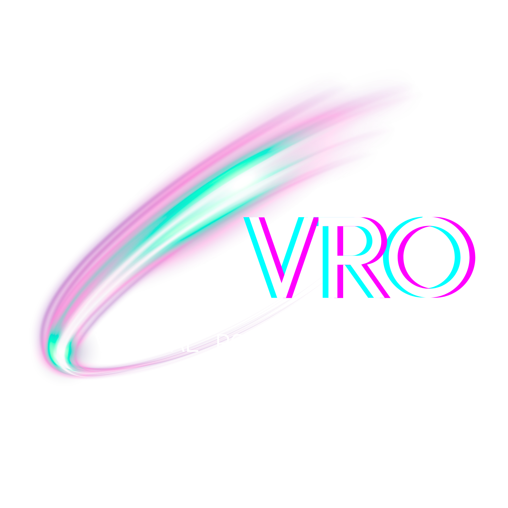

    

    Build and program a robot. Run time and measurement simulations, or compete globally!

    <a href="https://starvulkan.github.io/VRO/"><b>Live demo →</b></a>

<h1>About VRO (Virtual Robotics Olympiad)!</h1> 

VRO is a web app to help you discover the world of robotics! Configure and program a robot to complete missions on our yearly season's game mat to score points and compete globally for best score and time, or run time and measurement simulations to help your team out in competitions like WRO and First Lego League!

Coder

---

Robot mechanical configurator

---

<h1>Features!</h1>

## Currently functional:

1. VRO Season 2026-27 game mat.
2. Functional block-based robot coder with basic block types. (Based on Blockly!)
3. Code file saving, using the `.vro` file format.
4. Mechanical robot configurator.
5. More code blocks (more sensors, motors, plotting, etc).

## Still to come:

1. Scoring round mode for VRO's seasonal game mats.
2. Global leaderboards for the current VRO season challenge.
3. Time/measurement simulation mode, with the possibility to add any custom game mat (to run simulations for WRO, FLL, etc).

<h1>DEVELOPMENT FOR VRO IS CURRENTLY ON HOLD, EXPECT NO CHANGES SOON!</h1>

